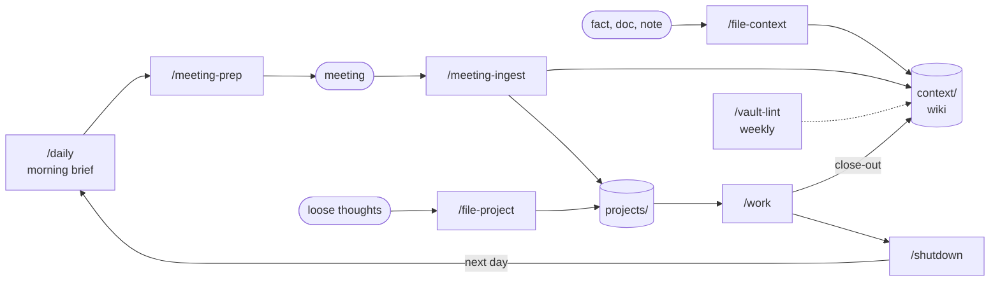

# Project Vault Blueprint

A ready-to-copy Obsidian vault in which Claude Code keeps the project's knowledge, todos and daily routine up to date. You drop in raw material (meeting notes, documents, loose thoughts). Claude files it into a curated wiki, turns actions into tracked projects, and gives you a morning brief.

It follows the **LLM Wiki** pattern: knowledge compounds in maintained pages instead of being re-derived from raw sources every time you ask.

## What's inside

| Path | What |
| --- | --- |
| `vault-template/` | The empty vault: copy it, fill the Project facts, start working |
| `GUIDELINES.md` | How to work with it: the loop, dos and don'ts, lessons learned, data handling, extending |
| `guidelines/claude-working-style.md` | Optional: a working style for Claude Code (autonomy, quality gates) |
| `examples/` | Filled-in fictional files: a project, its inbox, a meeting |
| `MANIFEST.md` | Every shipped file and why it is there |

## The daily loop

## Layers

| Layer | Folder | Rule |
| --- | --- | --- |
| Schema | `CLAUDE.md`, `templates/`, `bases/`, `context/categories/` | Structure, types, views |
| Wiki | `context/` | Single source of truth, maintained by Claude |
| Raw | `source/` | Immutable inputs; read, never edited |
| Staging | `_inbox/` | Drops awaiting ingestion |
| Action | `projects/` | Projects, todos, artifacts |
| Daily | `daily/` | Generated morning briefs |

## Types

Every file has a `type` that links to a hub page in `vault-template/context/categories/`. The hub page **is** the type's definition: what it is for, where it lives, filename, frontmatter, sections, and which skill creates and processes it.

| Type | Lives in | Created by | Processed by |
| --- | --- | --- | --- |
| [Topic](vault-template/context/categories/Topic.md) | `context/topics/` | owner decision | `/file-context`, `/meeting-ingest` |
| [Meeting](vault-template/context/categories/Meeting.md) | `source/meetings/` | `/meeting-prep` | `/meeting-ingest` |
| [Project](vault-template/context/categories/Project.md) | `projects/<date slug>/` | `/file-project` | `/work` |
| [Task](vault-template/context/categories/Task.md) | `projects/tasks.md`, project headers, open questions | `/meeting-ingest`, `/shutdown` | `/daily`, Dashboard |
| [Person](vault-template/context/categories/Person.md) | `context/people/` | template, `/meeting-prep` | `/email`, `/teams-read`, queries |
| [Report](vault-template/context/categories/Report.md) | `context/reports/` | on request | `/vault-reindex` |
| [Daily](vault-template/context/categories/Daily.md) | `daily/` | `/daily` | `/shutdown` |
| [Analysis](vault-template/context/categories/Analysis.md), [Communication Draft](vault-template/context/categories/Communication%20Draft.md) | project folders | `/file-project`, `/work` | `/work` |
| [Research](vault-template/context/categories/Research.md), [Source](vault-template/context/categories/Source.md) | `source/` | import | `/file-context` |
| [Decision](vault-template/context/categories/Decision.md), [Overview](vault-template/context/categories/Overview.md) | `context/`, `projects/` | on request | `/vault-lint` |
| [Template](vault-template/context/categories/Template.md), [Indexfile](vault-template/context/categories/Indexfile.md), [Logfile](vault-template/context/categories/Logfile.md), [Category](vault-template/context/categories/Category.md) | schema files | setup | `/vault-lint`, `/vault-reindex` |

## Skills

| Skill | Does | Status |
| --- | --- | --- |
| `/daily` | Morning brief: calendar (if connected), due tasks, focus list | core |
| `/meeting-prep` | Meeting file with briefing, prep checklist, questions | core |
| `/meeting-ingest` | Meeting notes → wiki facts, tasks, projects | core |
| `/file-context` | One fact → the right topic section | core |
| `/file-project` | Loose thoughts → structured project | core |
| `/work` | Next step of a project, close-out into the wiki | core |
| `/shutdown` | End-of-day wrap | core |
| `/vault-lint` | Health check: frontmatter, links, stale pages, todos | core |
| `/vault-reindex` | Rebuild the wiki catalog | core |
| `/email` | Outlook drafts and invites in your voice; never sends | optional |
| `/teams-read` | Fast read of Teams chats | optional |

Optional skills live in `.claude/skills-optional/`; move a folder into `.claude/skills/` to enable it. Both need the Microsoft 365 connector in Claude.

## Setup

1. **Prerequisites:** Obsidian ≥ 1.9 (Bases), Claude Code, Python 3. Optional: Microsoft 365 connector (calendar in `/daily`, `/email`, `/teams-read`), macOS for the scheduled brief.
2. **Copy** `vault-template/` to where the project vault should live, rename the folder, `git init`.
3. **Fill the placeholders** (table below). Find them with `grep -rnE "__[A-Z_]+__" --exclude-dir=.git .` (Python dunders like `__file__` are lower case and don't match).
4. **Open as vault** in Obsidian. Install and enable the community plugins **Tasks**, **Linter** and **Git**. Settings for Tasks and Linter ship in `.obsidian/plugins/*/data.json`; Git runs on its defaults.
5. **Optional skills:** move them from `.claude/skills-optional/` to `.claude/skills/`; fill `email/voice.md`.
6. **Optional scripts:** see `scripts/optional/` (scheduled `/daily`, Confluence sync).
7. **Check:** `uv run --with pytest pytest scripts/vault` (or `pip install pytest` first) and `python3 scripts/vault/vault.py find type=Category` (lists all 17 hubs).
8. Read `GUIDELINES.md`, then start with `/meeting-prep` or `/file-project`.

### Placeholders

| Placeholder | Where | Meaning |
| --- | --- | --- |
| `__PROJECT_NAME__` | `CLAUDE.md` | Project name |
| `__CLIENT_NAME__` | `CLAUDE.md` | Client organisation |
| `__PROJECT_GOAL__` | `CLAUDE.md` | Project goal in one sentence |
| `__OWNER_NAME__` | `CLAUDE.md` | Who leads the project and decides |
| `__OWNER_SHORT_NAME__` | `CLAUDE.md` | Sign-off name in mails |
| `__CLIENT_EMAIL_DOMAIN__` | `CLAUDE.md` | Mail domain of client staff (internal vs. external) |
| `__WIKI_LANGUAGE__` | `CLAUDE.md` | Language of all vault content |
| `__COMMUNICATION_LANGUAGE__` | `CLAUDE.md` | Language of mails and invites |
| `__TIME_ZONE__` | `CLAUDE.md` | e.g. Europe/Berlin |
| `__DATA_POLICY__` | `CLAUDE.md` | The client's AI/data policy (name or link) |
| `__SETUP_DATE__` | `context/`, `projects/`, `daily/` | Setup date, ISO `YYYY-MM-DD` |
| `__VAULT_DIR__` | `scripts/optional/daily-brief.plist` | Absolute path of the vault |
| `__CONFLUENCE_BASE_URL__`, `__CONFLUENCE_EMAIL__`, `__KEYCHAIN_SERVICE__` | `scripts/optional/confluence/` | Confluence sync settings |

`{{…}}` in `templates/` are template variables, not placeholders — leave them.
